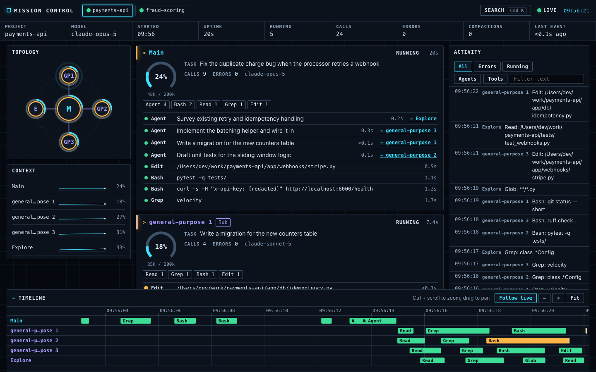

# cc-mission-control

A Claude Code plugin that opens a live local dashboard for your session. It shows every agent working in the session (the main thread and each subagent), what each one is doing, how much of its context window it has used, and every tool call it makes. It runs on your machine, only observes, and never blocks or changes a tool call.



**Quick start:** in Claude Code run `/plugin marketplace add papoveB01/cc-mission-control`, then `/plugin install cc-mission-control@papoveb01`, then start a new session. The dashboard opens at http://127.0.0.1:4317/. Needs Python 3.10+ and [uv](https://docs.astral.sh/uv/) (see Requirements).

**What's new in 0.12.0:**
- **Complete session costs:** subagents that ran before the dashboard server saw a session now count in the session total (totals could be up to 58% low before).
- **Correct context gauges:** each model gets its real context window from a table (1M for Fable/Mythos 5.x, Opus 5.5/5/4.8/4.7/4.6, Sonnet 5.5/5/4.6 and Haiku 5.5; 200K for older models), so a 1M model no longer shows "hot" at 180K.
- **Fable 5.2 and Mythos 5.2 prices.** The price table is dated 2026-11-27.
- **Every cost is marked as an estimate** ("~$1.64"). On a subscription, Live says "API-equivalent value, covered by your Max plan." The dashboard reads only the plan type from Claude Code's `.claude.json`; set `CCMC_PLAN_DETECT=0` to turn that off.
- **Hub:** on first start the hub rebuilds and rescores its history in the background, which takes a few minutes. Ingest keeps working throughout.

**What's new in 0.11.1:**
- **Dismiss:** the "needs you" banner and every attention-queue row on Live have a Dismiss button. It hides that occurrence only: a new wait, more errors, context getting hot again after a compaction, rising drift or a changed Mac alert brings it back. Dismissed items stay under **Dismissed (N)** with Restore, and counts elsewhere still include them. This browser remembers dismissals for 24 hours.
- **Fix:** the Details panel under an attention-queue row was squeezed into one narrow column. It now spans the row.

**What's new in 0.11.0:**
- **Needs-you details:** every attention item, the "needs you" banner and the View screen now open a panel that says what is happening and how to fix it. A permission wait names the agent, the tool and the exact command, and shows Claude Code's suggested rules with a warning when a rule is broad. An idle wait quotes Claude's last message. Errors, full context, drift, wasteful tasks and Mac alerts each get their own steps. **Open in View** lands on the issue.
- **`PermissionRequest` hook:** the plugin now also listens to this event to know which agent is asking and for what. It never answers it: the hook always returns an empty response, which Claude Code treats as no decision.

**What's new in 0.10.0:**
- **Live is a dashboard:** the Constellation shows every project as a cluster and every running session as a globe (ring = context, spokes = subagents), with a "needs you" banner, an attention queue, a detail card, 60-minute charts of context, errors, tool use and cost, and a 30-minute timeline per project. The per-session screen moved to **View**.
- **System:** a new page for the machine running the dashboard (CPU, memory and pressure, swap, disk, load, top processes, Claude Code's total) and the dashboard server's own health, with alerts.
- **Task efficiency:** every finished task is rated efficient, typical or wasteful against your own similar tasks, with plain reasons (tokens per action, retries, cache reuse, repeated reads). It shows in Live, View and Reports, which gains an Efficiency column, filter and tab. The hub upgrades its database on first start (migration 7) and rescores history in the background.

**What's new in 0.9.0:**
- **Projects:** the side panel groups sessions under their project. Worktrees and sub-repositories join the project that holds the shared `CLAUDE.md` or `.claude/` folder.
- **Conventions:** a new page checks each project's `CLAUDE.md` files and skills against 19 rules of an agentic development process: roles, model per role, isolated worktrees, risk tiers, independent review, tests that prove the fix, your approval for irreversible actions, reversibility, secrets, honest reporting and more. Each rule shows where it is covered, or offers suggested text. It is a local checklist: nothing is sent anywhere.
- **Add to CLAUDE.md:** a missing rule's text can be added to the project's `CLAUDE.md` after a preview, with Undo. Nothing is committed. `CCMC_CONVENTION_RUBRIC` points at your own rubric file to replace or extend the built-in rules.

**What's new in 0.8.0:**
- **Side panel and menu:** the session tabs are in a panel on the left (`S` collapses it), and the header is a menu: Live, Reports, History and Settings. Reports and History open the hub.
- **Settings:** display preferences in one place, plus a read-only view of the server and the hub connection.
- **All-sessions graph:** the overview has a `[Sessions | Graph]` switch (`G`) that shows every active session with its subagents.
- **Drift risk:** an estimate, from warning signs, that a session is losing track, with copyable `/compact` and handoff text. It does not detect hallucination, and nothing outside a session can run `/compact` for you.
- **Fix:** the context color of the session tabs could stop updating, so a session passing 70% might not blink or move to the front.

**What's new in 0.7.3:**
- **Subagent panel:** opening a subagent shows at the top which session spawned it, the task it is running, and its context now, with tokens processed and estimated cost.
- **Repeats badge:** placeholder titles such as "(pasted text)" are no longer marked as repeating in Reports.

**What's new in 0.7.2:**
- **Context-colored tabs:** each live session tab is tinted from green to red by its main agent's context. A session over 70% moves to the front, right after All sessions, and blinks until it drops back. If you've turned on reduced motion, it gets an outline instead of blinking.
- **Readable task titles in Reports:** each task shows a short title (for example "COMMS daily venue-media report check") with a one-line detail. Expanding a task shows the full prompt, up to 2,000 characters, one sentence per line. Recurring briefs get a `Repeats ×N` badge, and there is a Repeating filter to hide them or show only them. The hub adds titles to past tasks when it upgrades.

**What's new in 0.7.1:** a report task's context window is never below its peak context, so peak context no longer shows above 100% for agents that moved to a 1M window. The hub rebuilds affected rows on its own.

**What's new in 0.7.0:** a Reports screen in the history UI, which is now its landing page.
- **Filters:** date, session, main agent or subagents, agent type, a specific agent, tools used, outcome, errors and files touched. All filters live in the URL, so a view can be shared as a link.
- **Results:** every matching task with its description, peak context used and estimated cost, plus summary tiles, a daily chart, and Errors, Usage and Breakdown tabs.
- **Hub upgrade:** the hub database gains per-task peak context, tool counts and file attribution. Past sessions fill these in on their own after the upgrade.

**What's new in 0.6.0:**
- **A calmer live dashboard:**
  - A status band at the top shows what needs you, with red for an agent waiting for you, a failed agent, or context over 90%, and amber for things to watch.
  - One table lists every agent, sorted so the ones that need you come first. Each row has a "now:" line and expands in place.
  - The graph and the timeline are one key away.
  - The activity feed shows key events by default.
- **All sessions overview:** combined context, running cost, tasks, main agents, current subagents, completed tasks and errors across every session, with a sessions table and a combined activity feed.
- **Token accounting and estimated cost:** per agent, per session and in the history hub.
- **Task and error report:** in the history UI.

0.5.0 was not published separately; its changes are part of 0.6.0.

**What's new in 0.4.0:** the Activity feed describes each step in plain language with its result ("Ran the test suite, 489 passed"), with a Plain | Technical toggle. Optional AI summaries add a one- or two-sentence recap after each turn and helper agent (see [AI summaries](#ai-summaries-optional)).

**What's new in 0.3.1:** after a plugin update, the next session replaces the older dashboard server automatically.

**What's new in 0.3.0:** optional remote history. A relay on the local server forwards redacted records to a self-hosted hub (Docker + Tailscale) with a searchable history UI, token usage, file access and permission indexes. Off unless you set `CCMC_UPSTREAM_URL`.

**What's new in 0.2.3:** the project folder is read from the transcript when the dashboard joins a session mid-way; licensor attribution updated.

**What's new in 0.2.2:** sessions show Claude Code's session name (the name you set with `/rename`, else the title Claude Code generated), and the folder is kept as the project.

**What's new in 0.2.1:** the dashboard reloads itself once after an update (with a manual button if it still differs), the timeline row-label fix for long sessions, injected prompts (cross-session messages, task notifications) no longer replace the task while typed slash commands show as the task, the session title keeps the folder you started in, and the dashboard page is served with no-cache headers so an open tab picks up the new build.

**What's new in 0.2.0:** the dashboard is redesigned as a dark HUD. It adds an agent topology graph, radial context dials with context history, an agent detail modal (click any agent), a tool-call timeline dock, a command palette (Ctrl/Cmd+K), keyboard shortcuts and feed filters. The light theme is gone; there is one dark theme.

What it shows:

- **Status band.** What needs you right now (an agent waiting for you, a failure, a context window close to full), agents running, the context peak, recent errors, cost and cost per minute.
- **Agent table.** One row per agent with its status, task, what it is doing now, a context bar, calls, cost and time. Click a row for its recent calls and tool tally.
- **All sessions overview.** Combined totals across every session on the machine, a sessions table and a combined activity feed.
- **Current task per agent.** Your prompt for the main thread; the delegated description for each subagent.
- **Tool calls per agent.** Tool name, one-line summary, status (running, succeeded, failed) and duration. Click a call to see its full input and output, redacted.
- **Graph and timeline.** A graph of the main agent and its subagents, and every tool call as a bar on a time axis, so parallel work is visible. Both are one key away.
- **Session activity feed** with filters. Prompts, tool calls, subagent start and finish, compactions, notifications and failures across all agents.
- **Multiple sessions.** Each Claude Code session on the machine is its own tab.

More screenshots: [agent detail modal](docs/screenshot-modal.png), [command palette](docs/screenshot-palette.png).

## Requirements

- Claude Code. Tested with 2.1.287; the minimum supported version has not been established. Background subagents (the default since 2.1.198) are handled.
- Python 3.10 or newer, available on your PATH as `python3`.
- [uv](https://docs.astral.sh/uv/) is recommended. On the first session the launcher uses uv to create the server's virtualenv in the plugin data directory (installing FastAPI and uvicorn), so there is nothing to install by hand and the environment survives plugin updates.
- Without uv, the launcher still works if `fastapi` and `uvicorn` are importable by `python3`. The launcher only checks those two, but `websockets` and `httpx` are needed as well, so install all four: `pip install fastapi uvicorn websockets httpx`. If neither is true, it prints an install hint for uv to stderr and does nothing else; Claude Code is not affected.

You do not need Node. The dashboard is prebuilt and committed to the repository.

## Install

### Manual install (always works)

Inside Claude Code:

```
/plugin marketplace add papoveB01/cc-mission-control
/plugin install cc-mission-control@papoveb01
```

Or from a terminal:

```
claude plugin marketplace add papoveB01/cc-mission-control
claude plugin install cc-mission-control@papoveb01
```

Start a new Claude Code session afterwards. If hooks do not seem to be active, run `/hooks` and check that the plugin's hooks are listed.

### Per project, through `.claude/settings.json`

To have the dashboard travel with a repository, commit this to the project's `.claude/settings.json` (also in [`examples/project-settings.json`](examples/project-settings.json)):

```json
{
  "extraKnownMarketplaces": {
    "papoveb01": {
      "source": {
        "source": "github",
        "repo": "papoveB01/cc-mission-control"
      }
    }
  },
  "enabledPlugins": {
    "cc-mission-control@papoveb01": true
  }
}
```

Two caveats:

- Claude Code reads `extraKnownMarketplaces` from a repository's settings only after you accept the workspace trust dialog for that folder. In an untrusted folder (including `claude -p` runs) the entries are ignored silently.
- Whether `enabledPlugins` installs the plugin automatically depends on your Claude Code version and settings file. If a teammate does not get it, have them run the manual install above.

### What happens on first start

When a session starts, the `SessionStart` hook runs `scripts/launch.py`. It starts the server if one is not already running (or replaces a running one that is older than the plugin, after confirming through `server.pid` and `ps` that it is a cc_mission_control process; on Windows the old server is kept), sends it the start event, and opens `http://127.0.0.1:4317/` in your browser. The first run can take a few seconds while uv builds the environment; later starts take milliseconds. The browser opens once: further sessions appear as tabs in the open dashboard, and the browser is not opened on `/clear` or compaction restarts.

If no browser opens (remote or SSH session, `CCMC_NO_BROWSER=1`, `CLAUDE_CODE_REMOTE=true`, or no `open`/`xdg-open`), go to http://127.0.0.1:4317/ yourself.

The first start downloads dependencies, so it needs network access. If the dashboard does not appear, wait a minute, start a new session, and check `server.log` in the data directory (`~/.claude/plugins/data/cc-mission-control-papoveb01/`).

The server logs to `server.log` in the plugin data directory (`~/.claude/plugins/data/cc-mission-control-papoveb01/` for a plugin install; `~/.cc-mission-control/` if the launcher runs outside Claude Code). It exits by itself after 30 minutes with no active session and no open dashboard.

### Disable or uninstall

```
claude plugin disable cc-mission-control@papoveb01
claude plugin uninstall cc-mission-control@papoveb01
```

Uninstalling also deletes the plugin's data directory (the virtualenv and `server.log`) unless you pass `--keep-data`.

### Update

```
claude plugin marketplace update papoveb01
claude plugin update cc-mission-control@papoveb01
```

Then start a new session.

## Using the dashboard

The page is a single dark view. From left to right and top to bottom:
- **Header:** the menu (Live, Reports, History, Settings), then search, the connection state and the clock.
- **Side panel:** the session tabs, with **All sessions** first. Press `s` to shrink it to a narrow rail.
- **Identity line:** a muted line under the header, at the top of the main area.
- **Status band:** what needs your attention.
- **Working area:** the agent table on the left and the activity feed on the right.
- **Timeline dock:** along the bottom, collapsed by default.

The layout follows the width of the main area, not the window, because the side panel takes part of it. With less than 1100 px of main area, the feed moves below the table. Under 900 px, the side panel becomes a strip of tabs under the header and everything stacks in one column.

### Menu and settings

- **Live** is the dashboard. **Reports** and **History** open the hub's pages (same tab) once the server knows the hub's address, which it takes from `CCMC_UPSTREAM_URL`. Without a hub they open a short note (`#/hub`) that names `CCMC_UPSTREAM_URL` and `CCMC_UPSTREAM_TOKEN` and points to `deploy/hub/`.
- **Settings** (`#/settings`) holds display preferences that apply at once and are saved in your browser: activity wording, activity scope, the session view, the All sessions view, the side panel and the timeline, with a Reset to defaults button. Below them it shows the hub connection (not configured, connected, waiting for the first delivery, or not reachable, with the records queued, spooled size, records dropped and last delivery) and the server's settings, each with the environment variable that sets it. The server's settings are read-only: change the variable and restart the server. Secrets such as the hub token and the summary key are never shown.
- The browser's Back and Forward buttons work between the pages. Choosing a session or All sessions from Settings takes you back to Live. The palette and `s` still work on the Settings page; `g`, `t`, `f` and `e` do nothing there.
- The history pages carry the same menu (Live, Reports, History, File lookup). Live goes to `http://127.0.0.1:4317/`.

### Sessions and side panel

- **Tabs:** one per Claude Code session, active ones first; ended sessions follow under an "Ended" label and are dimmed. A red or amber dot on a tab means that session has something that needs you, or something to watch. The context percentage shows at the right of each tab.
- **All sessions tab:** sits first, and is selected by default when two or more sessions are active. Otherwise the most recently started active session is selected. Once you pick a tab it stays selected until you change it. `[` and `]` move between the tabs, with All sessions first. In the panel, the arrow keys, Home and End move and select.
- **Context colors:** a tab is tinted from green to red by its main agent's context, shown as a colored left edge. Over 70%, the tab moves to the front of the active ones, right after All sessions, and blinks, except while you are viewing it. The tooltip shows the exact percentage.
- **Tab names:** each tab shows the session's name. Hover it to see the full name, the project folder, the start time and where the name came from (your `/rename`, auto-generated by Claude Code, or the folder).
- **Rail:** press `s` or the button at the top of the panel to collapse it to a 56 px rail that keeps each tab's dot, color and tooltip and shows the first two characters of its name. The choice is remembered in this browser.
- **Identity line:** a muted line at the top of the main area shows the session name, model, start time and uptime. Hover it for the token breakdown.
- **Browser tab title:** starts with `(N)` when N agents need you, so you can see it from another window.

### Status band and alerts

The band answers "does anything need me?" at a glance.

**Alert levels:**
- **Needs you (red):** an agent is waiting for you, an agent failed in the last 5 minutes, or a running agent's context is over 90%.
- **Watch (amber):** context 60–90%, a tool call running for more than 2 minutes, an error in the last 5 minutes, or no events for over a minute while an agent is running.

Everything else is uncoloured. Alerts clear themselves when their cause goes away.

**Tiles:**
- **Needs you.**
- **Agents:** running, waiting and done.
- **Context peak:** the highest context % and which agent.
- **Errors in the last 5 minutes:** with the total below.
- **Cost:** with the cost per minute over the last 5 minutes. Marked `avg` when there isn't 5 minutes of data yet.
- **Time since the last event.**

Click Needs you or Context peak to jump to that agent. Click Errors to open the next failed call.

### Agent table

One row per agent:
- status (running, waiting, failed, done or idle);
- the agent's name (subagents of the same type are numbered: `general-purpose 1`, `general-purpose 2`, ...);
- the task, and a "now:" line with what it is doing at the moment;
- a context bar with marks at 60% and 80% (it reads "n/a" until a transcript is found);
- calls and errors, estimated cost, and elapsed time.

**Order:** agents that need you come first, then ones to watch, then the rest. Within each group the order is waiting, failed, running, idle, done, with the main agent first.

**Rows:**
- Finished subagents fold into one "N finished" row.
- Click a row to expand it: the full task, a subagent's result and spawn link, tokens and cost, the tool tally and the last 8 calls.
- Click an agent's name to open its detail modal.
- With a single agent, its row starts expanded.

**Graph view:** the `[Agents | Graph]` switch (or `g`) shows the agents as a graph instead. The main agent is in the center with subagents around it, and each node shows its context usage. Your choice is remembered in your browser.

**Context window and history:** the window is 200,000 tokens unless the model is a 1M model (see `CCMC_CONTEXT_WINDOW`). Each agent's context history is recorded in your browser from the moment the page loads. It is shown in the agent's detail modal, kept in memory only (up to 300 points per agent), and lost when you reload.

### All sessions overview

A view across every session the dashboard is holding.

**Band tiles:**
- **Needs you:** across all sessions.
- **Main agents:** active, working and ended.
- **Subagents now:** with completed and failed below.
- **Tasks:** your prompts plus subagent runs, with completed and running counts.
- **Errors:** total, and in the last 5 minutes.
- **Context peak:** with the session and agent, and the total tokens currently in context.
- **Cost:** total, with the combined cost per minute.

**Sessions table:** one row per session, with its main agent's status and "now:" line, context bar, subagents, tasks completed out of total, errors, cost and last activity. Ended sessions fold into one row. Click a row to open that session.

**Combined activity feed:** key events from every session, each labelled with its session. Click one to open that session, and the call itself when it is still in memory.

### Agent detail modal

**Opening it:** click an agent's name in the table, a graph node, an agent name in the feed or timeline, a spawn link, or an agent result in the palette.

**Contents:**
- for a subagent, a summary at the top: "Spawned by <session name>" (with "via <agent>" when another subagent spawned it), what it is doing ("Running the task …", "Finished the task …"), and its context now with tokens processed and estimated cost;
- the agent's type, status, elapsed time, model and id (with a copy button);
- a large dial with its full context history;
- the full task text and, for subagents, the final result;
- lineage: which call spawned a subagent, or a main agent's subagents;
- the tool tally;
- every call the dashboard has for that agent (filter by all, running or errors, or by text);
- that agent's feed entries.

It updates live. "Show in table" closes the modal and scrolls to the agent's row. Esc or a click outside closes it.

### Call drawer

Click a call anywhere (an expanded row, the timeline, the feed, the palette or the modal) to open a drawer on the right. It shows the call's full redacted input, output, error, timestamps and duration. Esc closes it.

### Timeline dock

One row per agent, with time along the x axis. Each call is a bar from start to end, coloured by status; a running call extends to now. Overlapping bars show parallel work. Hover a bar for the tool, summary and duration, and click it to open the call drawer.

**Controls:**
- **Zoom:** Ctrl/Cmd + scroll (or pinch), or the `-`/`+` buttons.
- **Pan:** drag, or Shift + scroll.
- **Follow live:** keeps the right edge at now. It switches off when you pan.
- **Fit:** shows the whole session.

**The dock itself:** it starts collapsed. `t` opens and closes it, and you can resize it by dragging its top edge or with the arrow keys. It shows the last 60 calls per agent. Its height and collapsed state are remembered in your browser.

### Activity feed and filters

The feed is newest first, across all agents. Auto-scroll pauses while you scroll.

**Scope:** **Key** (the default) shows prompts, subagent starts and finishes, waits, compactions, permission denials, turn ends, summaries and failed calls. **All** adds every tool call.

**Filters:**
- **Errors only:** a chip in the toolbar.
- **Filter ▾:** opens the agent and tool selectors, a text box and the Plain | Technical toggle. It shows how many filters are active.

Filters also dim, rather than hide, the non-matching calls in expanded rows and the timeline. The table header shows "Filtered" while any filter is on. Filters are saved per browser (`localStorage`). `f` opens the filter box, and `e` opens the next error call.

### Command palette

Press Ctrl+K (Cmd+K on macOS) or use the Search button. Type to fuzzy-search sessions (including All sessions), agents, recent calls and actions: go to Live, Reports, History or Settings, switch between the agents and graph views, toggle the timeline, toggle the side panel, follow live, fit the timeline, clear filters, jump to the next error, show shortcuts. Arrow keys move, Enter runs, Esc closes.

### Keyboard shortcuts

Single-key shortcuts are ignored while you are typing in an input or while Ctrl, Cmd or Alt is held. On the All sessions view only Ctrl/Cmd+K, `?`, `[` / `]`, `g`, `s` and Esc apply. On the Settings and hub pages only Ctrl/Cmd+K, `?`, `[` / `]`, `s` and Esc apply.

| Key | Action |
|---|---|
| Ctrl+K / Cmd+K | Open or close the command palette |
| `?` | Show the shortcuts sheet |
| `[` / `]` | Previous / next tab (All sessions comes first) |
| `s` | Show or hide the side panel (rail) |
| `g` | Switch to the graph view and focus it |
| `t` | Toggle the timeline dock |
| `f` | Open the feed filter |
| `e` | Open the next error call |
| Esc | Close the top overlay |

Colour is used only for alerts. When your system asks for reduced motion, the remaining animations are switched off: the single pulse when something new needs you, eased bars, and node pulses in the graph.

Some messages you will see:

- **Launched in background.** Claude Code runs subagents in the background by default, so the `Agent` tool call that spawns one completes right away. The call shows "Launched in background"; the subagent's own row carries the live status.
- **No result reported (blocked or cancelled).** A tool call fired its start hook but no result ever came, usually because the call was blocked before running (for example by a sandbox) or cancelled. The call is closed as an error when the agent stops. If a late result does arrive, it replaces this and the error count is corrected.
- **Denied.** An auto-mode permission denial. The call is marked as an error with the reason.
- **Interrupted.** A call you interrupted.

## Configuration

All settings are environment variables, read when the server starts.

| Variable | Default | Purpose |
|---|---|---|
| `CCMC_PORT` | `4317` | Default 4317. Changing it requires a modified copy of the plugin (see Port). |
| `CCMC_DATA_DIR` | `$CLAUDE_PLUGIN_DATA`, else `~/.cc-mission-control` | Logs, pid file, virtualenv. |
| `CCMC_CONTEXT_WINDOW` | `200000` | Window used for gauges when the model is not in the built-in window table. A model ID containing `1m`, or observed usage above the window, switches that agent to 1,000,000. |
| `CCMC_IDLE_MINUTES` | `30` | Shut the server down after this long with no active session and no open dashboard. `0` disables. |
| `CCMC_STALE_MINUTES` | `60` | Mark a session ended after this long with no hook event and no transcript growth (a killed terminal never sends `SessionEnd`). A later event reactivates it. |
| `CCMC_MAX_CALLS` | `500` | Tool calls kept in memory per agent. |
| `CCMC_MAX_FIELD_CHARS` | `4000` | Truncation length for captured inputs and outputs. |
| `CCMC_REDACT_FILE` | unset | Path to a file of extra redaction regexes (see Security and privacy). |
| `CCMC_NO_BROWSER` | unset | `1` = never open the browser automatically. |
| `CCMC_UPSTREAM_URL` | unset | Forward redacted records to this URL as JSON arrays of v2 envelopes. Off by default; when unset, nothing is created or sent. Records are spooled to `<data dir>/relay/` and retried with backoff until the upstream accepts them. |
| `CCMC_UPSTREAM_TOKEN` | unset | Bearer token sent to the upstream. |
| `CCMC_SPOOL_MB` | `200` | Cap on the relay spool on disk. Past it, the oldest segments are deleted and counted as dropped (shown in `/health`). |
| `CCMC_SUMMARIES` | unset | `1` = AI summaries of each turn and subagent (see AI summaries). Also needs the key file. |
| `CCMC_SUMMARY_KEY_FILE` | `<data dir>/summary_api_key` | File holding the Anthropic API key for summaries. Ignored, with a log line, unless it is a regular file with no group or other permissions (mode 0600). |
| `CCMC_SUMMARY_MODEL` | `claude-haiku-5-5` | Model used for summaries. |
| `CCMC_SUMMARY_MAX_PER_HOUR` | `30` | Rate cap per rolling hour. Excess requests are skipped and counted in `/health`. |
| `CCMC_PRICING_FILE` | unset | JSON file that replaces the built-in API price table used for cost estimates (see Token usage and cost). Also read by the hub. |
| `CCMC_PLAN_DETECT` | `1` | `0` = do not read the plan type from `.claude.json` (see Token usage and cost). |
| `CCMC_CONVENTION_RUBRIC` | unset | Path to your own JSON rubric for the Conventions review (`{"version": 1, "extends": "builtin" or null, "disable": [ids], "rules": [...]}`). Regexes are capped at 300 characters, at most 60 rules. A rule may take its suggested text from a Markdown heading with `suggest_from: {file, heading}` (file relative to the rubric's folder). An unreadable or invalid file falls back to the built-in rubric, and Settings shows why. |
| `CCMC_DEV_ORIGINS` | unset | Comma-separated extra allowed `Origin` values, for the Vite dev server only (for example `http://localhost:5173`). |
| `CCMC_LAUNCH_DEADLINE` | `17` | Launcher only. Seconds after which the `SessionStart` launcher gives up and exits 0, so it always finishes inside the hook's 20 second timeout. |

Set these in the environment Claude Code runs in (the launcher passes its environment on to the server), for example in the `env` block of your Claude Code settings or your shell profile.

### Port

The port is fixed at 4317 in v0.1. Claude Code cannot read environment variables or plugin options in an HTTP hook URL, and there is no supported way to override a plugin's hooks, so the URLs in `hooks/hooks.json` are literal. If 4317 is taken by another program, the launcher detects it (via `/health`), logs a message to stderr and does nothing; Claude Code is unaffected. To use another port you must run a modified copy: fork or clone the repo, replace `4317` in all 15 URLs in `hooks/hooks.json`, set `CCMC_PORT` to the same value, and start Claude Code with `claude --plugin-dir <your-clone>`. Do not edit files under `~/.claude/plugins/cache/`; plugin updates overwrite them.

### Organization policies

If you or your organization set `allowedHttpHookUrls` in Claude Code settings, it must include `http://127.0.0.1:4317/*` (or your port) or the HTTP hooks will not run and the dashboard stays empty:

```json
{ "allowedHttpHookUrls": ["http://127.0.0.1:4317/*"] }
```

Entries merge across settings files; once the key is defined, HTTP hooks that match no entry are blocked.

### Windows

`hooks.json` starts the launcher with `python3`, which often does not exist on Windows. Replace `"command": "python3"` with `python` or `py` in the `SessionStart` entry. Make the edit in a fork or a `claude --plugin-dir` clone, not under `~/.claude/plugins/cache/`, which plugin updates overwrite. This has not been tested on Windows by the author.

## Security and privacy

- **Local only.** The server binds to `127.0.0.1` and never to other interfaces. It rejects requests whose `Host` header is not `127.0.0.1:<port>` or `localhost:<port>` (DNS rebinding), and rejects `/hook`, `/api/*` and `/ws` requests carrying a foreign `Origin`, so a web page you visit cannot inject events or read the stream.
- **Nothing leaves your machine** unless you set `CCMC_UPSTREAM_URL`. When set, the server forwards each event, already redacted, with two added fields: `machine_id` (first 12 hex characters of the SHA-256 of the hostname) and `user` (OS username). The hook URLs never change; hooks always post to the local server, which relays.
- **Redaction is best effort.** Every captured string is redacted before it is stored, displayed or forwarded, then truncated. A secret in a format the patterns do not recognize will be visible in the dashboard on your machine. Built-in patterns cover: private key blocks, Anthropic keys (`sk-ant-`), generic `sk-` keys, GitHub tokens (`ghp_`, `gho_`, `ghu_`, `ghs_`, `ghr_`, `github_pat_`), Slack tokens (`xox[abprs]-`), AWS access key IDs (`AKIA` or `ASIA`), Google API keys, JWTs, Bearer tokens, and values following `api_key`, `secret_key`, `secret`, `token`, `password`, `passwd`, `pwd`, `access_key`, `client_secret` or `private_key` with `:` or `=` (the key is kept, the value masked; key names match case-insensitively and accept `-` or `_`, so `api-key` and `API_KEY` both count). Nested objects are walked, and dictionary keys are redacted too. Matches become `[redacted]`.
- **Adding patterns.** Put one Python regular expression per line in a file and point `CCMC_REDACT_FILE` at it. Lines starting with `#` are comments, and invalid regexes are skipped (with a warning in the log). The whole match is replaced with `[redacted]`.

  ```
  # internal token format
  corp_[A-Za-z0-9]{32}
  ```
- **Observe only.** The hooks never return a decision, so the dashboard cannot block, approve, delay or alter a tool call. HTTP hooks have a 2 second timeout, and a connection failure or non-2xx response is non-blocking: if the server is down or hangs, Claude Code carries on unaffected.
- **Import safety.** The launcher starts the server with the plugin data directory as its working directory and with implicit current-directory imports disabled, so a file in the project you are working in cannot shadow the server's imports.

## How it works

```
Claude Code ── SessionStart (command hook) ──► scripts/launch.py ── starts server, opens browser
     │
     ├── 15 HTTP hooks (POST JSON, 2 s timeout) ──► FastAPI server on 127.0.0.1:4317 ── WebSocket /ws ──► dashboard
     │
     └── transcript .jsonl files ◄── transcript tailer (context usage)
```

- **Hooks.** 17 events: one `command` hook (`SessionStart`, which does not support HTTP hooks) and 16 `http` hooks for the rest (`UserPromptSubmit`, `PreToolUse`, `PostToolUse`, `PostToolUseFailure`, `SubagentStart`, `SubagentStop`, `Stop`, `StopFailure`, `Notification`, `PreCompact`, `PostCompact`, `TaskCreated`, `TaskCompleted`, `PermissionRequest`, `PermissionDenied`, `SessionEnd`). `/hook` always answers 200 with an empty body, which Claude Code reads as "no decision".
- **Context usage.** Hooks do not report it. The server tails the session transcript (and each subagent's transcript) and sums `input + cache_creation + cache_read + output` tokens from the latest assistant turn. Transcripts are written asynchronously, so a gauge can trail the live turn by a moment.
- **Linking subagents to their lanes.** In order of preference: the spawn call's response (`tool_response.agentId`), then the `agent-<id>.meta.json` file Claude Code writes next to the subagent transcript, then first-in-first-out matching of pending spawn calls by agent type.
- **Updates.** The server keeps state in memory, batches changes every 150 ms and pushes them to the browser over a WebSocket. Nothing is persisted; restarting the server clears the view.


## AI summaries (optional)

Off by default. When on, the dashboard adds a one or two sentence, past-tense summary at the end of each main turn (only if it had at least 3 activity rows) and when each subagent finishes. It appears in the Activity feed as a highlighted "Summary" block, in both Plain and Technical modes, and is relayed to the hub so history shows it too. The hub never calls the API.

To enable it:

```bash
umask 077
mkdir -p ~/.cc-mission-control && printf '%s' 'YOUR_ANTHROPIC_API_KEY' > ~/.cc-mission-control/summary_api_key
```

Then add `"CCMC_SUMMARIES": "1"` to the `env` block of `~/.claude/settings.json` and restart Claude Code. Use `CCMC_SUMMARY_KEY_FILE` for another location (the default is `summary_api_key` in the data dir). If the flag is set but the file is missing or readable by group or others, summaries stay off and one line is logged (never the key). `/health` shows a `summaries` block (`enabled`, `sent`, `failed`, `skipped`, `last_error`).

- **Model and cost.** `claude-haiku-5-5` by default (`CCMC_SUMMARY_MODEL`). Each summary is one small request (at most about 8,000 characters in, 200 tokens out) billed to your Anthropic API account, at most `CCMC_SUMMARY_MAX_PER_HOUR` (30) per hour.
- **Privacy.** When enabled, redacted activity text is sent to the Anthropic API: your prompt (first 1,000 characters), the plain-language activity lines with their outcomes (up to 60 lines), and the agent's final message (first 1,000 characters). Redaction is best effort, as everywhere else in this tool. Leave it off if that is not acceptable.
- **Why not `ANTHROPIC_API_KEY`.** The key is never read from that variable. Putting `ANTHROPIC_API_KEY` in `settings.json` `env` would switch Claude Code itself to API billing and expose the key to every shell it starts. A separate 0600 file keeps the key scoped to this feature.
- **Never blocks.** Requests go through a small queue (20, oldest dropped) and one background worker, with a 20 second timeout and one retry on 429, 5xx or network errors. A failed request adds no row.

## Token usage and cost

Every agent's tokens are counted from its transcript (`message.usage`): input, cache writes (5 minute and 1 hour), cache reads, output, and server-side web search and fetch requests. Counting starts at the beginning of each transcript, so a session that was already running when the server started is counted in full. A message that Claude Code writes in several streamed pieces is counted once, at its highest values. The AI summary calls (above) are counted separately as "Dashboard" usage and are included in the session total.

**Cost is an estimate.** It is the token counts multiplied by Anthropic API list prices (with the fast-mode and US-only inference multipliers and the web search charge). A subscription plan is not billed per token, and Bedrock and Vertex have their own prices, so treat the figure as a measure of size, not an invoice. Batch discounts and partner-cloud prices are not modeled. A message whose model is not in the price table counts toward tokens but not toward cost, and is listed as unpriced.

**Context window and plan note (0.12.0).** The gauge uses a per-model window table (1M for Fable, Mythos, Opus 4.6 and later, Sonnet 4.6 and later, Haiku 5.5; 200K for the 4.5 and older models), because transcripts record the bare model ID. An unknown model uses 1M when its ID has `1m`, else `CCMC_CONTEXT_WINDOW`. A pricing file may add a `context_windows` map that replaces the table. Subagent usage is counted in the session total even when the subagent never fired a hook. Cost figures say when your subscription covers them: the server reads only `oauthAccount.billingType` and `oauthAccount.organizationType` from `.claude.json` (`$CLAUDE_CONFIG_DIR` or your home folder), never your email or name, and `CCMC_PLAN_DETECT=0` turns that off. `GET /api/plan` returns `{"kind", "name"}`; the hub never receives it.

**Where costs appear.** Every cost carries a `~` and the tooltip "Estimated at API list prices", and exact values are in tooltips.

- **Live dashboard:** each agent row shows its estimated cost (an expanded row adds `<tokens> tok · ~$cost`), the status band shows the session total and cost per minute, the line under the tabs has the token breakdown in its tooltip (with the "Dashboard (AI summaries)" cost when there is any), the All sessions overview shows the total across sessions, and an agent's detail modal has a Usage table with input, 5 minute and 1 hour cache writes, cache reads, output, web searches, messages, estimated cost and any unpriced messages. A server older than v0.6.0 sends no usage, and those spots stay empty.
- **History, session Usage tab:** per-agent Type and Est. cost columns and a cost share bar next to the token bars.
- **History, Usage page (`#/usage`):** totals over Today, 7 days, 30 days, This month or a custom date range, filtered by machine and project and grouped by agent type (default), model, project, machine, session or day (days in your browser's time zone, oldest first). A session row opens that session's Usage tab. The footnote gives the price list date and lists models with no known price. The filters are in the URL hash, so a view can be linked.

`CCMC_PRICING_FILE` replaces the built-in table (prices as of 2026-10-30, taken from the Anthropic pricing page) with your own JSON file. It is read at start, by both the local server and the hub. An unreadable or invalid file logs one line and the built-in table is used. Prices are USD per million tokens, and model keys match a model name exactly or followed by `-` or `@` and an 8-digit date; the longest key wins.

```json
{
  "as_of": "2026-10-30",
  "web_search_per_1k": 10.0,
  "fast_multiplier": 2.0,
  "us_geo_multiplier": 1.1,
  "models": {
    "claude-opus-5-5": {"input": 4, "cache_write_5m": 5, "cache_write_1h": 8, "cache_read": 0.20, "output": 20},
    "claude-haiku-5-5": {"input": 0.10, "cache_write_5m": 0.125, "cache_write_1h": 0.20, "cache_read": 0.01, "output": 0.50,
                         "long_context": {"over": 100000, "input": 0.50, "cache_write_5m": 0.625,
                                          "cache_write_1h": 1, "cache_read": 0.05, "output": 2.50}}
  }
}
```

With the relay on, usage records go to the hub, which stores one row per API message (counts and ids only, no text) and keeps them after `CCMC_HUB_RETENTION_DAYS` removes the session. `GET /api/history/usage` returns totals and estimated cost over a time range, grouped by agent type, model, project, machine, session or day (`from` inclusive and `to` exclusive in epoch seconds, `group_by`, `tz` in minutes east of UTC, and `machine`, `project`, `agent_type` and `model` filters). After an upgrade the local server re-reads existing transcripts for counting but does not re-send usage it already relayed (`<data dir>/usage_relayed.json` remembers how far each file was sent).

## Task and error report

The hub's history UI has a **Tasks** page (`#/tasks`) and an **Errors** page (`#/errors`) covering every session, filterable by time range, machine, project and agent type. A session's page also has a **Tasks** tab. Nothing new is sent to the hub: the report is derived from the hook events it already has, so it also covers sessions recorded before this version (the hub fills them in on its next maintenance run).

- **A task** is one unit of work by one agent: a main-agent turn (from your prompt to `Stop` or `StopFailure`) or a subagent run. It ends `ok`, `error`, or `incomplete` (a new prompt or the session end came first), or is still `running`. Its outcome is the AI summary if there is one, else the agent's last message, else a count of actions and errors.
- **A failure** is a tool error, an interrupt, a permission denial, a call that was blocked or cancelled, or an API error that ended a turn.
- **Applied fix.** A failure counts as `fixed` when the same agent, in the same task, later made a successful call with the same target (the same file, the same kind of command such as the test suite, the same search). The report lists the edits made in between, how many tries it took, and the retry that worked. A failure that was never retried is `worked around` if the task still finished, and `unresolved` if it did not. Interrupts are `n/a`.
- **Fixed-rate trend.** The Errors page charts the fixed rate per agent type by day or week (a bucket with nothing to rate is a gap, not zero), with a table view of the same numbers.
- **Export CSV** on both pages downloads up to 10,000 rows for the current filters, with only the redacted summaries already stored (never full tool input or output). Cells that start with a formula character get a leading quote.

API: `GET /api/history/tasks`, `/failures`, `/report/summary`, `/report/trend` and `/sessions/{machine}/{session}/tasks` (SPEC 13.7). Tokens and estimated cost per task come from the usage records inside the task's window (see Token usage and cost).

## Differences from the spec and Claude Code notes

The design notes list every change made after checking against the live Claude Code hooks documentation. The ones that matter to users:

- **Subagents run in the background.** Since Claude Code 2.1.198 the spawning `Agent` call returns immediately with "Launched in background"; the subagent's row carries the live status. Results come back to the main agent as a `<task-notification>` prompt, which the dashboard logs as "result delivered to Main" instead of treating it as a new task.
- **Blocked calls have no result hook.** A call blocked before it runs fires its start hook but no result hook, hence "blocked or cancelled".
- **`PermissionDenied`** is a sixteenth event, added for auto-mode denials.
- **`PermissionRequest`** is a seventeenth event. It marks the asking agent as waiting and records the tool, its input and Claude Code's suggested rules. `/hook` still answers with an empty body, so Mission Control never approves or denies.
- **The subagent meta file is undocumented.** `agent-<id>.meta.json` was observed on Claude Code 2.1.x and could change. The dashboard prefers the documented `agentId` in the spawn response and parses the meta file defensively. If subagent transcripts are not where expected, that subagent's gauge shows "not available".
- **Context size includes output tokens**, matching Claude Code's own `context_tokens` definition. A 1M window is inferred from observed usage when the transcript records the bare model ID.
- **Agent IDs** appear with and without an `agent-` prefix in the docs; both are accepted.
- **A killed terminal** never sends `SessionEnd`, so silent sessions are marked ended after `CCMC_STALE_MINUTES`.
- **Project-level plugin config** needs workspace trust and may not prompt for installation (see Install).
- **Not included in v0.1:** hosted multi-user server, authentication, persistence across restarts, blocking or approving tool calls, cost in dollars (tokens only) and replay of past sessions.

## License

[Elastic License 2.0](LICENSE). Copyright (c) 2026 Papove Bombando Mfuana, the licensor. In plain language (not a substitute for the license text, see [`NOTICE`](NOTICE)):

- You may use, copy, modify and redistribute this software, including inside your company and in your own products.
- You may not provide it to third parties as a hosted or managed service.
- You may not remove or work around license keys or license notices.
